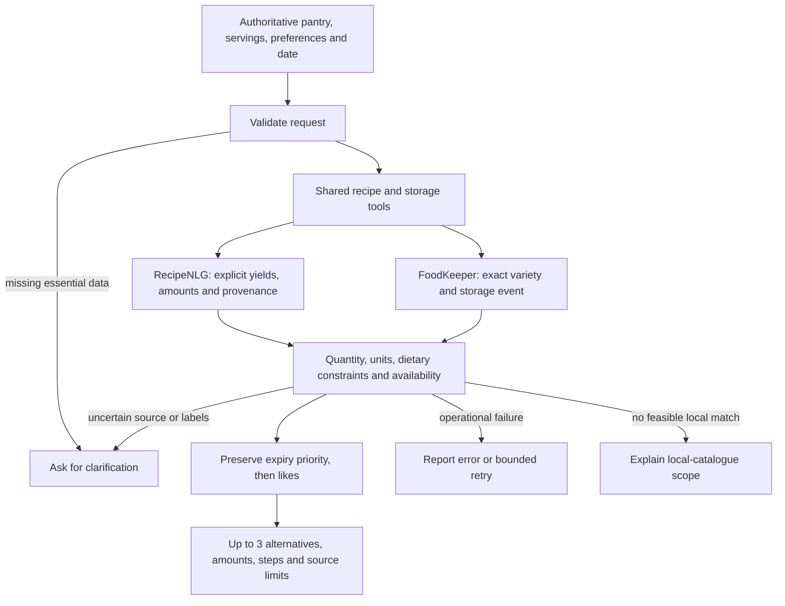
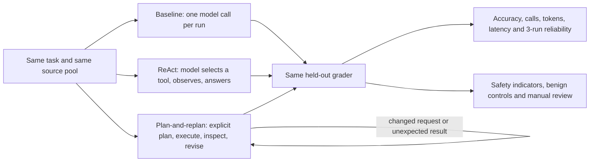

# System and experiment flow

## Plan-and-replan execution

1. Validate the authoritative input before model calls.
2. Ask the model for an explicit sequence of supported actions.
3. Execute common matching tools; never execute model-generated code or pantry edits.
4. On failure, no match, missing information or an explicit revised request, obtain a revised plan from the actual observation.
5. Retain shared candidate ranking. Generate a final JSON answer.
6. Validate the answer against the latest observation. Allow one bounded format repair; preserve failure evidence if it still fails.

This adds a planning/replanning phase rather than relabeling ReAct. It can cost more model calls; only the recorded comparison can establish whether that cost is useful.
